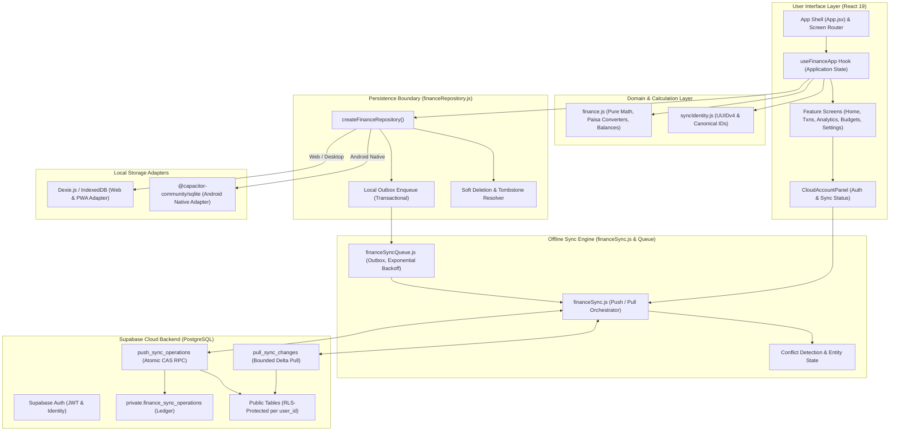
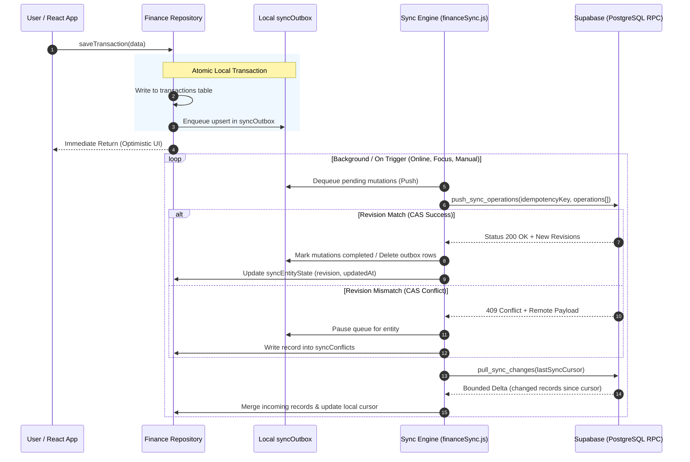

# PWS V1 — System Architecture Document

**Product:** PWS (Personal Wallet & Spending)  
**Version:** 1.0  
**Status:** Living Architectural Specification  
**Platform:** Progressive Web App (PWA) & Native Android (via Capacitor)  
**Primary Currency:** PKR (₨) with Paisa Precision  

---

## 1. Architectural Principles & Overview

PWS is designed around a **strict local-first, offline-capable, and privacy-preserving** architecture. Users can track expenses, manage budgets, and inspect analytics with zero internet connection and without requiring account creation. Cloud synchronization is an optional, non-blocking extension that provides multi-device sync and cloud backup without altering the local-first performance characteristics of the application.

### Core Architectural Tenets
1. **Local-First as the Single Source of Truth:** All reads and writes target the local embedded database first. Network calls are never in the critical path of user interactions.
2. **Persistence Boundary Abstraction:** Application UI and business hooks interact exclusively with a unified `FinanceRepository` interface. React components have zero awareness of whether the underlying storage is IndexedDB or native SQLite.
3. **Paisa Precision (Zero Floating-Point Drift):** All monetary figures (transactions, budgets, and balance calculations) are stored as integer paisas (`1 PKR = 100 Paisa`). Conversions to rupee displays occur only at the presentation boundary.
4. **Asynchronous Outbox Sync with Optimistic Concurrency:** Cloud synchronization operates through a durable transactional outbox with monotonic revision checks and idempotent compare-and-swap RPCs, preventing write collisions and silent overwrites.
5. **Strict Account Isolation:** A local device database is bound to one authenticated user ID. Queue operations written under a specific identity cannot leak into another account upon logout or switch.

---

## 2. System Architecture Diagram

---

## 3. Layered Design & Responsibilities

### 3.1. Presentation Layer (`src/features/` & `src/App.jsx`)
- **App Shell (`App.jsx`):** Renders skeleton loading screens during database hydration, evaluates onboarding completion guards, and manages top-level screen switching.
- **Hook-Driven State (`useFinanceApp.js`):** Encapsulates active tabs, form drafts, modal visibility, and database subscriptions. Invokes repository methods and keeps views reactively in sync.
- **Modular Feature Screens:**
  - `HomeScreen`: Summary card displaying cumulative available balance, budget vs. total expense metrics, the weekly spending trend chart, and recent transaction history.
  - `TransactionsScreen` & `TransactionDetailScreen`: Filterless chronological listing, single transaction inspection, and confirmation-gated deletion.
  - `AddTransactionScreen`: Expense creation/editing with title, amount (PKR with paisa validation), category selector, payment method picker, date, and optional notes.
  - `BudgetScreen`: Cumulative overall budget management, dated additions history, and category limit allocations.
  - `AnalyticsScreen`: Spending summaries, monthly totals, and category expense distributions.
  - `Settings Screens`: Onboarding, Categories manager, Payment Methods manager, Preferences, JSON Data Export, and Backup Restore.
- **Shared UI Primitives (`src/components/ui/`):** Accessible, standardized components (`Panel`, `ConfirmDialog`, `BackHeader`, `StatusMessage`, `NamedEntityManager`).

### 3.2. Domain & Calculation Layer (`src/lib/finance.js`)
All financial operations are pure functions with no side effects or database dependencies:
- **Paisa Conversion:** `toPaisa(rupees)` and `fromPaisa(paisa)` enforce rounding and integer guarantees.
- **Balance Aggregation:** `calculateExpenseTotal(transactions)` and `calculateCumulativeBudgetTotal(budgets, history)` derive real-time financial health.
- **Cumulative Budget Rule:** Available balance = Cumulative budget contributions minus all lifetime expenses.
- **Backup Payloads:** Serializes and validates schemas for JSON exports and verifies restored entities against versioned schemas.

### 3.3. Persistence Boundary (`src/services/financeRepository.js`)
The repository is the central access point for all persistence:
- **Platform Detection:** Evaluates `Capacitor.isNativePlatform()`. If running inside a Capacitor Android shell, it mounts `createNativeSqliteAdapter()`; otherwise, it mounts Dexie (`db.js`).
- **Atomic Local Outbox Insertion:** Every CRUD operation (`saveTransaction`, `deleteTransaction`, `setActiveBudget`, `saveCategory`, etc.) writes the entity update and an outbox mutation entry inside the same local database transaction.
- **Derived Entities:** Maintains the virtual `budget-all-overall` record, recalculating its cumulative total whenever budget additions or category allocations change.
- **Tombstoning & Visibility:** Inspects `syncEntityState` and `syncConflicts` during `loadData()`. Tombstoned records deleted remotely are hidden from views while preserving audit trails and conflict recovery data.

---

## 4. Local Database Adapters

### 4.1. Web & PWA: Dexie.js (`src/db/db.js`)
Configured with 6 incremental schema versions using IndexedDB:
- **v1:** Initial schema (`transactions`, `categories`, `paymentMethods`, `budgets`, `preferences`).
- **v2:** Transitioned to expense-only model: pruned income transactions and converted budgets to paisas.
- **v3 – v4:** Introduced `budgetHistory` table indexed by date, month, and category.
- **v5:** Injected sync identities (`syncId`, `categorySyncId`, `paymentMethodSyncId`) into all tables with automatic UUID backfilling.
- **v6:** Added local sync infrastructure tables:
  - `syncOutbox`: Pending mutations with status, retry schedule, and owner metadata.
  - `syncConflicts`: Unresolved revision conflicts and remote payloads.
  - `syncMetadata`: Key-value storage for sync cursors, tokens, and active account bindings.
  - `syncEntityState`: Tracks entity revisions and soft deletion timestamps (`deletedAt`).

### 4.2. Mobile: Native SQLite (`src/services/nativeSqliteAdapter.js`)
Used on Android devices via `@capacitor-community/sqlite`:
- Implements the exact same table schemas, compound indexes, and foreign key constraints as Dexie.
- Foreign keys with `ON DELETE RESTRICT` and `ON UPDATE CASCADE` prevent orphan transactions.
- Provides a Dexie-compatible collection query interface (`toArray()`, `get()`, `put()`, `add()`, `delete()`, `transaction()`) so the repository operates agnostically across platforms.

---

## 5. Cloud Synchronization Engine (`src/services/financeSync.js`)

### 5.1. Synchronization Guarantees
1. **Durable Outbox Pattern:** Mutations are stored persistently before network dispatch. Browser crashes or offline states will never lose queued changes.
2. **Exponential Backoff:** Failed network requests retry using jittered exponential backoff with a cap at `SYNC_MAX_AUTOMATIC_ATTEMPTS`.
3. **Compare-and-Swap (CAS) Protection:** Direct `INSERT`/`UPDATE`/`DELETE` permissions on PostgreSQL tables are revoked from clients. All mutations execute via the `push_sync_operations` stored procedure, which checks client revision against current database revision.
4. **Idempotency Ledger:** Each batch push submits an `idempotency_key`. The PostgreSQL function logs processed hashes in `private.finance_sync_operations`, ensuring duplicate network submissions do not cause duplicate inserts.
5. **Conflict Resolution:** If a revision conflict occurs, the record is placed in `syncConflicts`. Users can inspect conflicts via `CloudAccountPanel` and choose whether to accept the local or remote version.

---

## 6. Supabase Cloud Database Architecture

The backend schema lives in `supabase/migrations/`:

| Migration File | Description |
| :--- | :--- |
| `20261026000100_finance_auth_foundation.sql` | Per-user public tables (`categories`, `payment_methods`, `transactions`, `budgets`, `budget_history`, `preferences`), Row-Level Security (RLS) policies scoped to `auth.uid()`, and foreign key constraints. |
| `20261026000200_finance_sync_queue.sql` | Adds monotonic `revision` counters, the isolated `private.finance_sync_operations` idempotency table, client table permission revoking, and atomic stored procedures (`push_sync_operations`, `pull_sync_changes`). |

---

## 7. Backup, Export, and Migration Strategy

- **JSON Data Portability:** Users can export the entire database at any time to an unencrypted JSON backup file.
- **Export Scrubbing:** Sync internal outboxes, tokens, and metadata are intentionally excluded from backups to protect credentials and prevent queue desynchronization upon restore.
- **Merge on Restore:** Restoring an existing backup queues fresh upsert mutations in the local outbox, allowing the sync engine to merge restored records safely with cloud data.
- **Migration Verification:** [migrationVerification.js](file:///F:/Projects/Finance_App/src/services/migrationVerification.js) provides self-testing sanity checks comparing legacy Dexie databases against migrated SQLite equivalents to guarantee zero data loss.

---

## 8. Development, Testing, and Verification Matrix

| Area | Primary Test File | Coverage Focus |
| :--- | :--- | :--- |
| **Financial Math** | `src/lib/finance.test.js` | Paisa arithmetic, currency formatting, balance calculation, edge-case budgets. |
| **Persistence Repo** | `src/services/financeRepository.test.js` | Transactional CRUD, seeding, soft deletes, cumulative balance derivation. |
| **Native SQLite** | `src/services/nativeSqliteAdapter.test.js`, `nativeSqlite.test.js` | DDL execution, constraints, transaction rollbacks, Android parity. |
| **Sync Engine** | `src/services/financeSync.test.js`, `useFinanceSync.test.js` | Outbox ordering, exponential backoff, CAS conflict handling, idempotency. |
| **Cloud Auth** | `src/services/useSupabaseAuth.test.js`, `supabaseClient.test.js` | Session restoration, account switching, local binding validation. |
| **Backup & Migrations**| `src/services/nativeBackupMigration.test.js` | Schema upgrade integrity, JSON export/restore verification. |

---

## 9. Future Evolution & Roadmap Alignment

1. **Phase 1-2 (Completed Baseline):** Local-first PWA, Dexie IndexedDB, Capacitor Android shell, and pure financial domain engine.
2. **Phase 3-4 (Current Implemented State):** Native SQLite adapter, outbox sync engine, Supabase PostgreSQL schema, and conflict resolver.
3. **Phase 5 (Next Steps):**
   - Live end-to-end multi-device verification with an active Supabase project.
   - Comprehensive UI end-to-end integration tests (Playwright / Cypress).
   - Biometric authentication for native Android and offline PIN locking.
